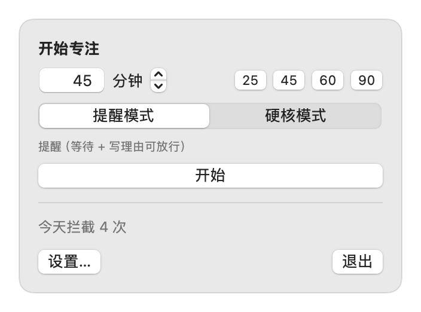
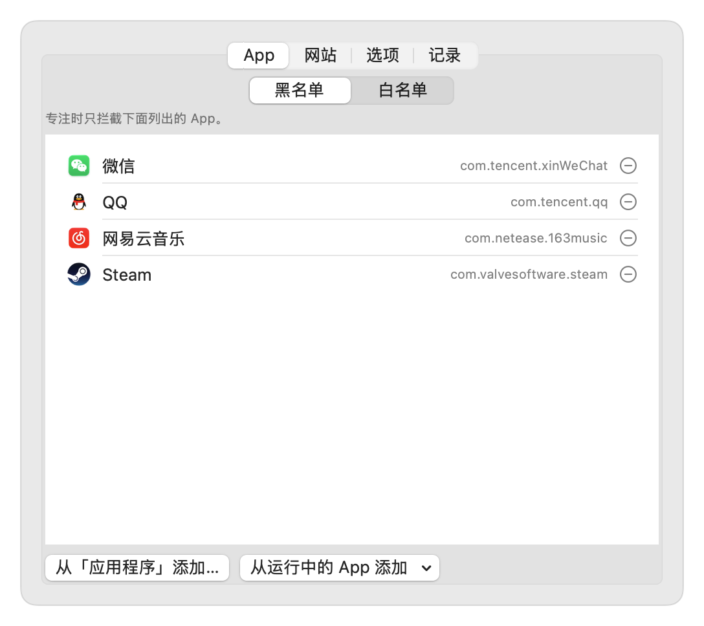
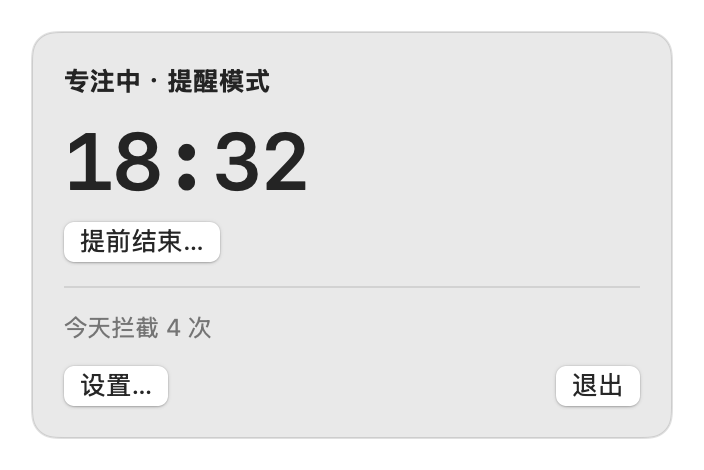
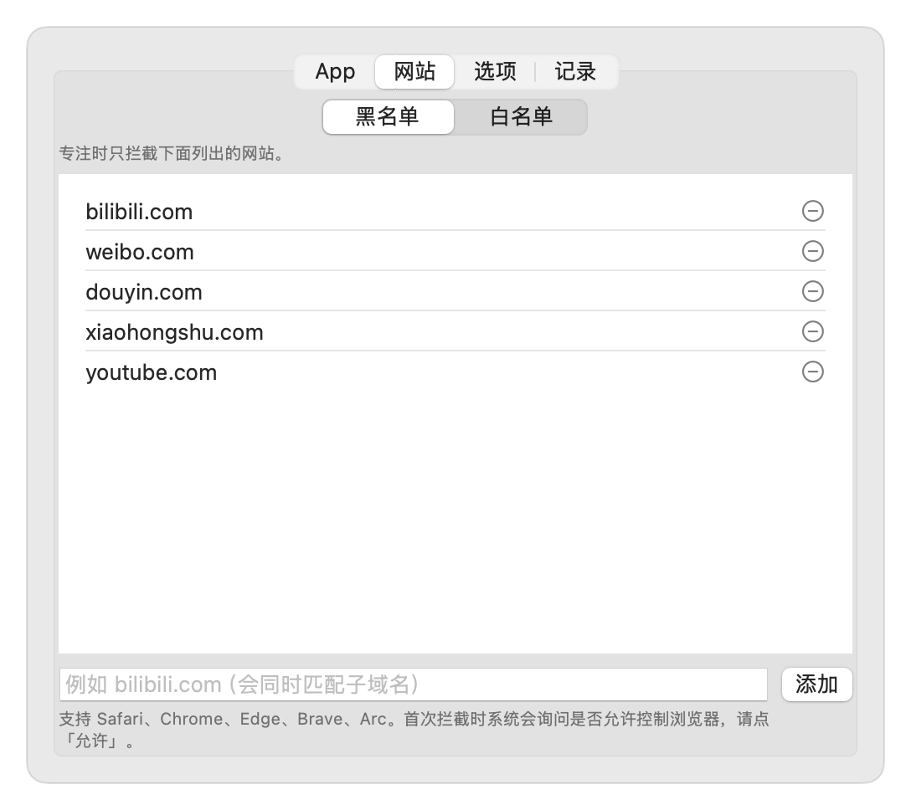
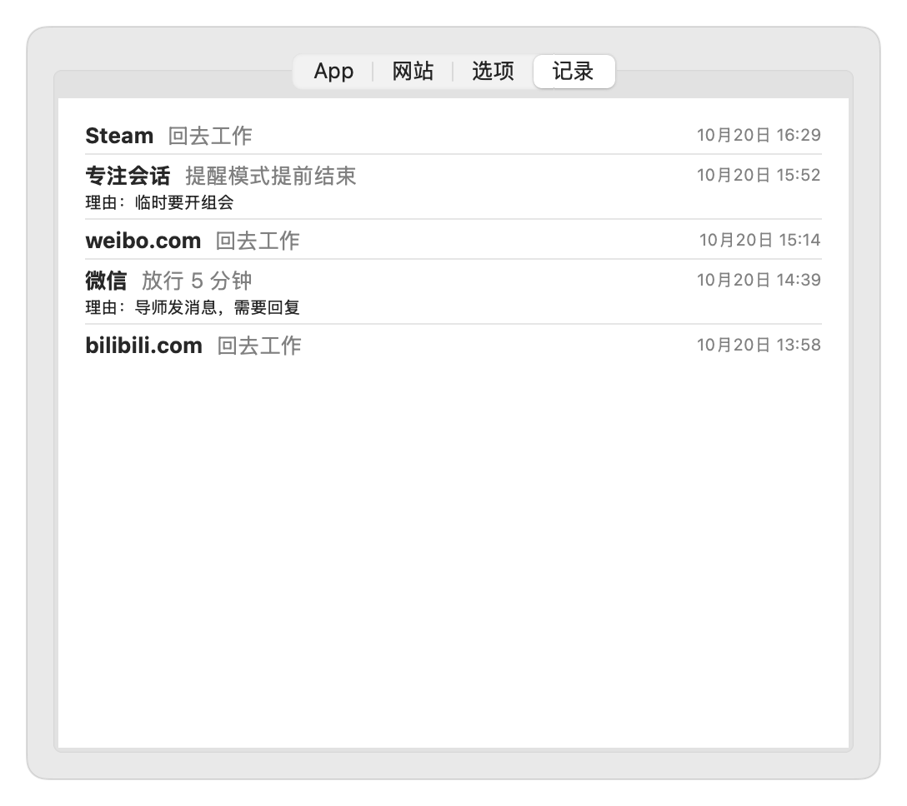

# FocusGuard

macOS 菜单栏自律工具：专注期间拦截摸鱼 App 和网站。

<p align="center">
  
  
</p>

## 快速上手

1. 到 [Releases](https://github.com/NonEspoir/focus_guard/releases) 下载最新的 `FocusGuard-x.y.z.zip`，解压后拖进「应用程序」。
2. 第一次打开会被系统拦截（App 没有经过 Apple 公证）：到「系统设置 → 隐私与安全性」点「仍要打开」。
3. 打开后菜单栏右上角会出现 ⌖ 图标，同时弹出主面板。点「设置…」，把摸鱼的 App 和网站加进黑名单（网站已预置 B 站、微博、抖音、小红书、YouTube）。
4. 在主面板输入专注时长，或者点 25 / 45 / 60 / 90 快捷按钮，选择模式，点「开始」。
5. 第一次拦截网页时，系统会询问是否允许 FocusGuard 控制浏览器，点「允许」。

需要 macOS 14 及以上，支持 Apple 芯片和 Intel。更详细的说明见 **[使用教程](docs/使用教程.md)**。

## 界面

### 菜单栏图标

平时显示 ⌖，专注中显示剩余时间：


菜单栏放不下时 macOS 会直接隐藏图标。这时从启动台或 Spotlight 再次打开 FocusGuard，也会弹出主面板。

### 主面板

| 开始专注 | 专注中 |
|:---:|:---:|
|  |  |

### 拦截遮罩（提醒模式）

打开黑名单里的 App 或网站时弹出。可以直接「回去工作」，也可以等待 10 秒、写下理由后临时放行 5 分钟。


### 设置

| 网站黑名单 | 拦截记录 |
|:---:|:---:|
|  |  |

## 功能

- **专注会话**：设定时长后开始，菜单栏显示倒计时。
- **两种模式**
  - 提醒模式：命中黑名单时隐藏该 App 并弹出全屏遮罩，可以选择「回去工作」，或者等待 N 秒、写下理由后临时放行。提前结束专注需要写理由。
  - 硬核模式：直接关闭 App 或标签页；会话期间无法正常退出，规则只能收紧不能放宽。每天只有一次无条件提前结束的机会。
- **黑名单 / 白名单**：App 和网站分别设置。黑名单只拦截列出的，白名单只允许列出的；两份名单分开保存，切换时不会丢失。
- **网站拦截**：支持 Safari、Chrome、Edge、Brave、Arc，不需要安装浏览器插件，匹配域名及其子域名。
- **拦截记录**：保留最近 30 天的拦截时间、处理方式和放行理由。

数据保存在 `~/Library/Application Support/FocusGuard/`。

## 从源码构建

只需要 Command Line Tools，不需要 Xcode：

```bash
./scripts/build_app.sh             # 只打包到 build/
./scripts/build_app.sh --install   # 打包并安装到 /Applications（启动台可见）
./scripts/build_app.sh --release   # 打包通用二进制并压缩成 zip，用于发布
./scripts/make_screenshots.sh      # 用演示数据重新生成 docs/images/ 里的截图
```

发布新版本时，先修改 `scripts/build_app.sh` 里的 `VERSION`。

## 待办

见 [TODO.md](TODO.md)。
